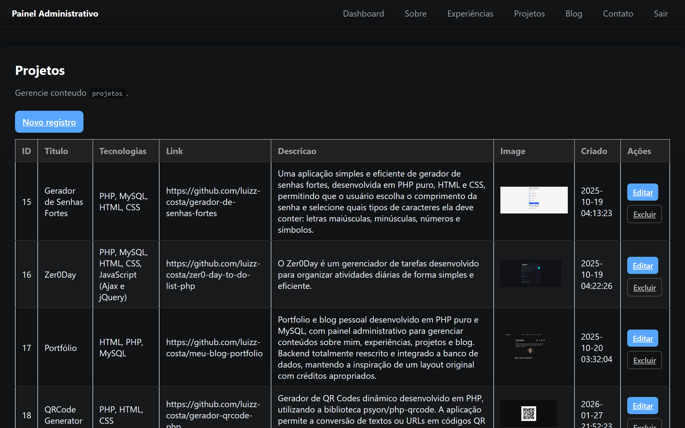
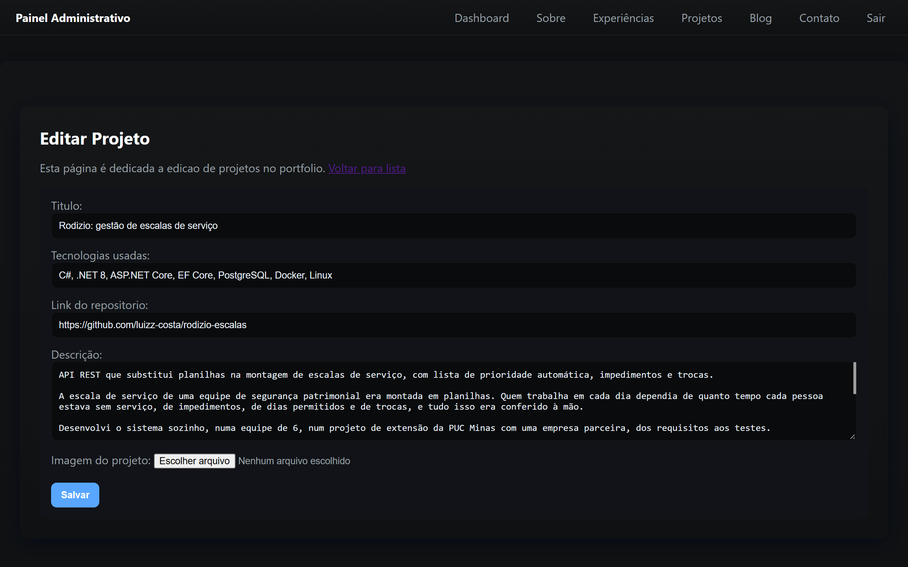
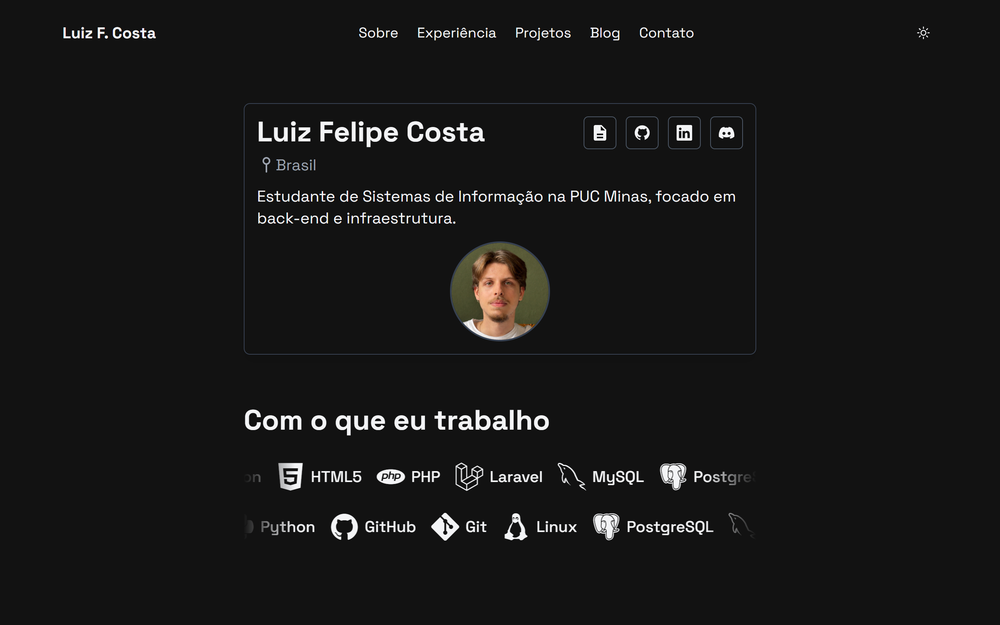
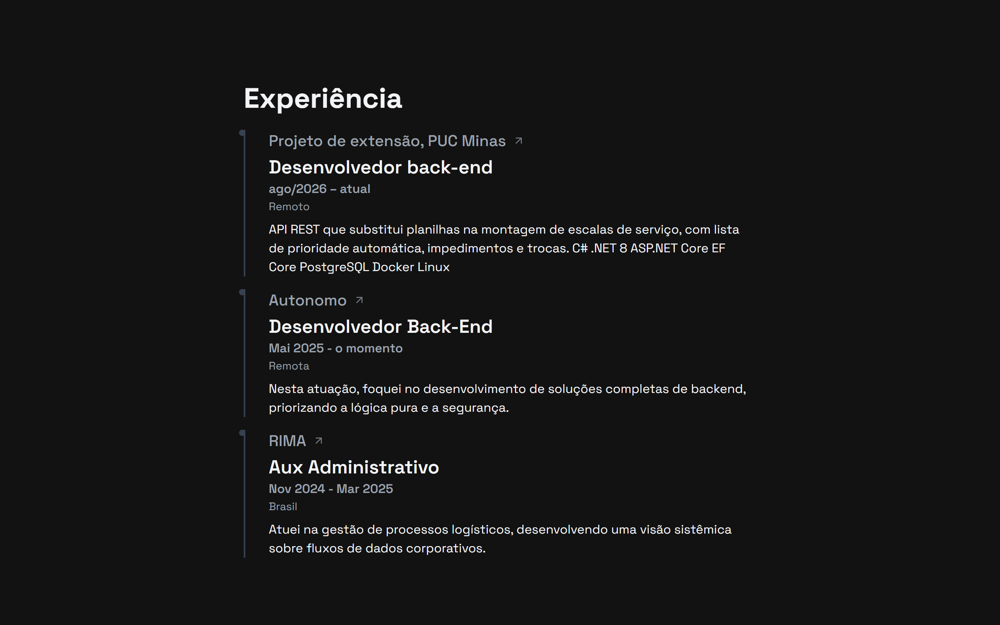

# Portfólio dinâmico com painel CMS (PHP e MySQL)

Meu portfólio anterior: um site pessoal em PHP puro e MySQL, com um **painel administrativo** para cadastrar, editar e excluir todo o conteúdo (sobre mim, experiências, projetos, posts do blog e contato) sem mexer no código.

O ponto de partida foi um tema estático do Hugo ([Hugo Noir](https://themes.gohugo.io/themes/hugo-noir/), licença MIT). Eu transformei esse tema em uma aplicação PHP: os templates viraram páginas PHP, o conteúdo saiu dos arquivos e foi para o banco de dados, e criei o painel com login para gerenciar tudo.

▶️ **Demonstração em vídeo:** [Desenvolvi um Portfólio 100% Dinâmico em PHP puro e MySQL](https://www.youtube.com/watch?v=ZfFr2-FqC6A)



## Funcionalidades

**Site público**
- Páginas de início, sobre, experiência, projetos, blog e contato, montadas a partir do banco.
- Posts do blog com URL amigável (`/blog/nome-do-post`) e páginas sem `.php` no endereço.
- Modo claro e escuro, layout responsivo.

**Painel administrativo**
- Login com e-mail e senha.
- CRUD de experiências, projetos e posts; edição de "Sobre mim" e contato.
- Upload de imagens para projetos, posts e foto de perfil, com troca e exclusão do arquivo antigo.



## Segurança

O que o projeto faz para proteger o painel e os dados:

- **Senhas com hash** (`password_hash` / `password_verify`), nunca em texto puro.
- **Todas as páginas do painel exigem login** antes de ler ou gravar qualquer dado; sem sessão válida, o usuário vai para o login.
- **Consultas parametrizadas** (`prepare` + `bind_param`) em todas as gravações e buscas com dados do usuário, contra SQL Injection.
- **Escape de saída** (`htmlspecialchars`) no site público e no painel, contra XSS.
- **Login com novo ID de sessão** (`session_regenerate_id`) e mensagem genérica para e-mail ou senha errados.
- **Upload restrito** a JPG e PNG de até 2 MB, salvo com nome aleatório.
- **Pasta `includes/` bloqueada** para acesso direto pelo navegador, listagem de diretórios desligada e credenciais do banco fora do repositório.

### Revisão de segurança (outubro de 2026)

Revisando o código um ano depois, encontrei e corrigi duas falhas da versão original:

1. As páginas do painel processavam o formulário **antes** de conferir o login. Quem enviasse uma requisição direto para a página conseguia criar, editar ou excluir conteúdo sem senha. Agora a verificação de sessão é a primeira coisa de cada página.
2. As gravações montavam o SQL juntando o texto digitado pelo usuário. Um apóstrofo já quebrava a consulta, e era uma porta aberta para SQL Injection. Agora todas usam consultas parametrizadas.

Na mesma revisão: escape de saída nas páginas que ainda não tinham, conexão em UTF-8 e caminhos que funcionam tanto na raiz de um domínio quanto numa subpasta.

**Limitações conhecidas:** os formulários ainda não têm token contra CSRF, e o código é procedural (uma página PHP por tela), sem framework.

## Tecnologias

- **Back-end:** PHP 8 (MySQLi), sessões
- **Banco de dados:** MySQL / MariaDB
- **Front-end:** HTML, Tailwind CSS, JavaScript
- **Servidor:** Apache com `.htaccess` (URLs amigáveis e bloqueio de pastas)
- **Hospedagem:** publicado em hospedagem compartilhada, com domínio próprio

## Banco de dados

Seis tabelas, criadas pelo [`includes/script.sql`](includes/script.sql):

| Tabela | Conteúdo |
|---|---|
| `about` | Nome, descrições e foto do "Sobre mim" |
| `experience` | Empresa, cargo, período, local e descrições |
| `projects` | Título, tecnologias, link, descrição e imagem |
| `blog` | Título, slug da URL, tecnologias, textos e imagem |
| `contact` | E-mail, GitHub e LinkedIn |
| `users` | Usuários do painel, com a senha em hash |

## Estrutura

```text
meu-blog-portfolio/
├── index.php, about.php, experience.php, projects.php, blog.php, contact.php   # site público
├── blog_post/post.php       # página de um post (/blog/slug)
├── admin/
│   ├── login.php, dashboard.php
│   ├── includes/            # auth.php (verifica a sessão), config.php, header, footer, logout
│   └── pages/               # sobre, experiencias, projetos, blog, contato (cadastrar, editar, listar, excluir)
├── includes/
│   ├── conexao.example.php  # modelo da conexão com o banco
│   ├── caminhos.php         # descobre se o site está na raiz ou numa subpasta
│   ├── upload.php           # validação e gravação das imagens
│   ├── header.php, footer.php
│   └── script.sql           # criação das tabelas
├── assets/                  # CSS, JavaScript e imagens enviadas pelo painel
└── .htaccess                # URLs amigáveis
```

## Como rodar localmente

Requisitos: PHP 8, MySQL ou MariaDB e Apache com `mod_rewrite` (o XAMPP já traz tudo).

1. Clone o repositório dentro da pasta do servidor (no XAMPP, `htdocs`):
   ```bash
   git clone https://github.com/luizz-costa/meu-blog-portfolio.git
   ```
2. Crie um banco (por exemplo, `portfolio_blog`, com `utf8mb4_general_ci`) e importe o `includes/script.sql`.
3. Copie `includes/conexao.example.php` para `includes/conexao.php` e preencha os dados do seu banco.
4. Crie o usuário do painel. Gere o hash da senha:
   ```bash
   php -r "echo password_hash('SUA_SENHA', PASSWORD_DEFAULT);"
   ```
   E insira no banco:
   ```sql
   INSERT INTO users (username, password, email, admin, created_at)
   VALUES ('admin', 'COLE_O_HASH_AQUI', 'admin@exemplo.com', 1, NOW());
   ```
5. Abra `http://localhost/meu-blog-portfolio/` para o site e `http://localhost/meu-blog-portfolio/admin/` para o painel.

O site funciona tanto numa subpasta (como no XAMPP) quanto na raiz de um domínio, sem mudar nenhuma configuração.

## Site público




## Créditos e licença

- Layout baseado no tema [Hugo Noir](https://themes.gohugo.io/themes/hugo-noir/), de [Pranam Shetty](https://github.com/prxshetty), licença MIT.
- Back-end em PHP e MySQL, painel administrativo e adaptações do layout: Luiz Felipe Costa, licença MIT.

Detalhes no arquivo [LICENSE](LICENSE).

## Autor

**Luiz Felipe Costa**: [portfólio](https://luizz-costa.github.io) · [GitHub](https://github.com/luizz-costa) · [LinkedIn](https://www.linkedin.com/in/luizz-costa/)

Este foi meu portfólio até 2026. O atual é um site estático feito com Hugo e publicado pelo GitHub Actions: [luizz-costa.github.io](https://luizz-costa.github.io).
